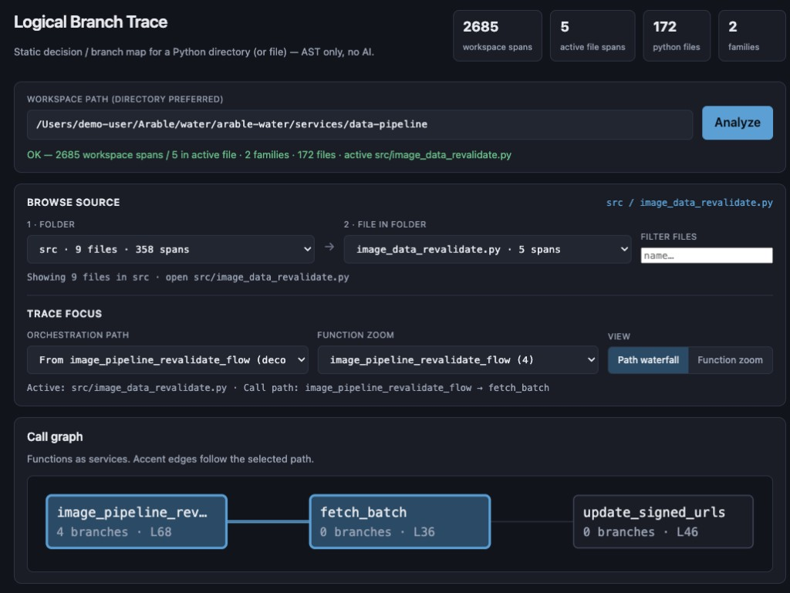

# Logical Branch Trace

**Static analysis for Python control-flow decisions — visualized like a distributed trace.**

Point the tool at a package directory (or a single `.py` file). It walks the tree, extracts logical branches with the Python AST, and serves a local browser UI: call graph, nested waterfall, and an LLM-ready Markdown report.

No AI in the loop. No npm. No third-party Python dependencies — **stdlib only**.



*Browse source (folder → file), pick an orchestration path, and inspect the call graph. Stats summarize workspace vs active-file branch density.*

---

## Why

Large data pipelines and services accumulate business decisions as `if`/`else`, feature flags, empty-frame guards, `fillna`, and DataFrame masks. Those decisions are hard to inventory from a code review alone.

Logical Branch Trace turns them into:

1. **A navigable trace UI** — folder → file → orchestration path → nested spans  
2. **A structured Markdown dump** — family-grouped predicates you can feed to an LLM (or a human) to propose higher-level decision clusters  

## Features

- Recursive directory scan (skips `.venv`, `__pycache__`, `.git`, …)
- Folder → file browse with span-density sorting
- Call-graph view (functions as “services”)
- Path waterfall and per-function zoom (line range ≈ duration, nesting ≈ span depth)
- Label modes: Compact / Wide / Full + conditions side panel
- Markdown report: copy, download active file, or whole workspace
- **Commit diff** — compare logical branches added / removed / updated between any two git revisions under a path
- CLI for CI / scripting (`--json`, `--markdown`, `--workspace-markdown`, `--diff-base` / `--diff-head`)
- Optional filesystem allowlist (`--root`) for safer local serving

## Requirements

- Python **3.10+** (3.11/3.12/3.13 fine)
- A modern browser

## Quick start

```bash
git clone <this-repo-url> logical-branch-trace
cd logical-branch-trace

python server.py --port 8765
```

Open [http://127.0.0.1:8765](http://127.0.0.1:8765)

1. Paste an absolute path to a Python **directory** (preferred) or `.py` file  
2. Click **Analyze**  
3. Pick **1 · Folder** → **2 · File**  
4. Explore the waterfall; use **Full + conditions** to read full predicates  
5. Copy or download the Markdown report for LLM grouping  

Deep-link (auto-runs Analyze):

```
http://127.0.0.1:8765/?path=/absolute/path/to/src
```

Restrict readable paths (recommended on shared machines):

```bash
python server.py --port 8765 --root /absolute/path/to/your/code
```

Repeat `--root` for multiple allowlisted trees.

## CLI

```bash
# Summary for a package
python analyze_branches.py /path/to/src --summary

# Focus one file under a directory
python analyze_branches.py /path/to/src --file package/main.py --summary

# Machine-readable JSON
python analyze_branches.py /path/to/file.py --json report.json

# LLM-oriented Markdown (active / default file)
python analyze_branches.py /path/to/src --markdown branches.md

# Full workspace Markdown (every .py with spans)
python analyze_branches.py /path/to/src --markdown workspace.md --workspace-markdown

# Logical branches added/removed/updated between two commits (path-scoped)
python analyze_branches.py /path/to/repo/or/subdir \
  --diff-base abc1234 \
  --diff-head def5678 \
  --summary

# Narrow further with a path filter + JSON / markdown
python analyze_branches.py /path/to/repo \
  --diff-base origin/main \
  --diff-head HEAD \
  --path-filter services/data-pipeline/src \
  --json branch-diff.json \
  --markdown branch-diff.md
```

Matching rules for the diff:

- **Unchanged** — same function + kind + condition text  
- **Updated** — same function + kind, condition edited (fuzzy match)  
- **Added / removed** — everything else  

Only `.py` files that differ between the two revisions are analyzed.
## HTTP API

| Method | Path | Body / query | Response |
|--------|------|--------------|----------|
| `GET` | `/api/health` | — | `{"ok": true}` |
| `POST` | `/api/analyze` | `{"path":"/abs/dir"}` | Directory index + active-file report |
| `POST` | `/api/analyze` | `{"path":"/abs/dir","file":"rel/path.py"}` | Same index, that file active |
| `POST` | `/api/analyze` | `{"path":"/abs/file.py"}` | Single-file report |
| `POST` | `/api/report` | `{"path":"…","scope":"active"\|"workspace"}` | `{"markdown":"…"}` |
| `POST` | `/api/report` | `{"scope":"active","report":{…}}` | Markdown from an in-memory report |
| `POST` | `/api/diff` | `{"path":"/abs/dir","base":"abc","head":"def","pathFilter"?}` | Branch add/remove/update report |
| `POST` | `/api/diff` | `{…, "markdown": true}` | `{markdown, summary}` for the same diff |

`GET /api/analyze?path=…&file=…` is also supported.

Static UI is served from `ui/` at `/`, `/app.js`, `/styles.css`.

## What counts as a branch

| Kind | Meaning |
|------|---------|
| `if` / `elif` / `else` | Explicit control flow |
| `ternary` | `a if cond else b` |
| `comprehension_if` | `[x for x in xs if …]` |
| `try` | Exception recovery paths |
| `fillna` | Per-row null → default (implicit branch) |
| `where_mask` | DataFrame boolean masks / `.where()` / `.mask()` / `.clip()` |

Also extracted:

- **Call graph** among functions defined in the same file  
- **Entrypoints** from `@flow` / `@task`, `if __name__ == "__main__"`, and call-graph roots  
- **Flow paths** — greedy walks from each entrypoint  
- **Nested spans** — children of `if` / `try` bodies  
- **Families** — heuristic clusters of similar predicates (empty guards, feature flags, …)

## Project layout

```
.
├── analyze_branches.py   # AST extractor + CLI + markdown generator
├── server.py             # Threading HTTP server (API + static UI)
├── ui/
│   ├── index.html
│   ├── app.js
│   └── styles.css
├── docs/
│   └── ui-overview.png   # README screenshot
├── README.md
├── LICENSE
└── .gitignore
```

## How the UI maps to “tracing”

| Trace concept | Static mapping |
|---------------|----------------|
| Service / process | Function on an orchestration path |
| Span | One logical branch |
| Start / duration | Source line → end line |
| Nesting | Branch entered inside a parent `if` / `try` |
| Terminal / error-ish | Early `return` (shown as ↩) |

## Security notes

- The server can read any `.py` file the OS user can read unless you set `--root`.  
- Bind defaults to `127.0.0.1`. Do not expose to the network without an allowlist and your own auth layer.  
- Generated reports may contain source snippets and paths — treat them as sensitive if the code is.

## Development

```bash
# Analyzer only
python analyze_branches.py ./sample_pkg --summary

# UI + API
python server.py --host 127.0.0.1 --port 8765
```

Edit `ui/*` and hard-refresh the browser (no build step). Restart `server.py` after changing Python modules.

## Roadmap / ideas

- Cross-file import-aware call graphs  
- Configurable family classifiers  
- SARIF or custom JSON schema export for CI gates  

## Contributing

Issues and PRs are welcome. Please:

1. Keep the **stdlib-only** constraint unless there is a strong reason not to  
2. Prefer small, focused changes (analyzer vs UI vs docs)  
3. Add a short note to this README when you change CLI flags or API shapes  


## Acknowledgments

Inspired by distributed-tracing UIs (Jaeger / Zipkin-style waterfalls), applied to **static** decision inventory rather than runtime spans.
